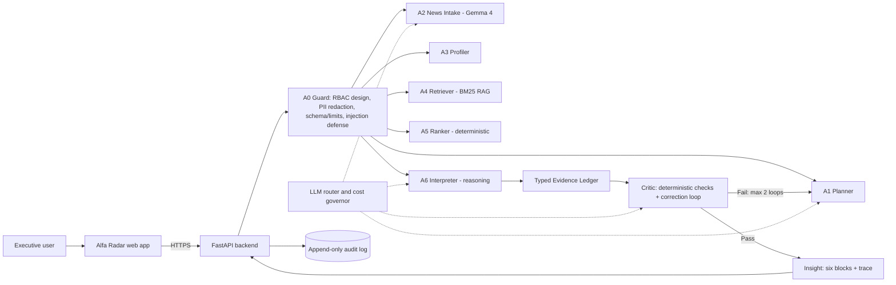

# Alfa Radar

News → Impact → Action engine for Alfa-Business. For every selected client and
user role, Alfa Radar answers six questions about an event and labels every
sentence as **Факт (Fact)**, **Позиция банка (Bank View)** or **Вывод ИИ
(AI Inference)**, each traceable to a source and to the company features that
drove it.

> Alfa Hack 2026 · Case: News Analytics for Business Decisions · Version 1.0

Every conclusion is produced by a team-implemented agent stack (no external
multi-agent framework) that plans, calls allowlisted read-only tools, writes a
typed Evidence Ledger, and is policed by a Critic with a correction loop.

## What it does

For a company × news event × role, the service produces an insight with six
blocks:

1. Что произошло — what happened
2. Почему это важно для вашей компании — why it matters for this company
3. Возможные последствия — possible consequences
4. Какие действия могут быть актуальны — relevant actions
5. Как это оценивает банк — Alfa-Bank's view
6. На чём основаны выводы — the basis (sources, company features, Critic)

Each claim carries a type (`FACT` / `BANK_VIEW` / `AI_INFERENCE`), source ids,
the company features used and a confidence value.

## Architecture



Components (team-implemented):

- **A0 Guard** — tool allowlist, parameter validation, PII masking before
  prompts, audit log. (Authentication/RBAC is described in
  [`docs/security.md`](docs/security.md), not fully implemented.)
- **A1 Planner** — fixed, cheap plan; writes it via `plan_write`, checks
  `budget_check`.
- **A2 News Intake** — classification + entity/fact extraction (Gemma 4),
  schema-validated JSON.
- **A3 Profiler** — deterministic company profile and payment-graph exposure.
- **A4 Retriever** — BM25 over the bank research corpus with page citations.
- **A5 Ranker** — deterministic relevance (`config/scoring.yaml`), role
  preference tie-break, MMR-style diversification.
- **A6 Interpreter** — six-block insight with typed claims and role guidance.
- **Critic** — deterministic checks (source coverage, bank-view grounding,
  company-feature reference, contradictions), up to 2 correction loops.
- **LLM router / cost governor** — model routing, disk cache, daily budget
  (RUB 500), fallback to a cheaper model.

## Quickstart (Docker)

Requires Docker with Compose v2. Full setup and troubleshooting: [`setup.md`](setup.md).

```bash
docker compose up --build
```

- Web app: <http://localhost:3000>
- API docs (OpenAPI): <http://localhost:8000/docs>
- Health: <http://localhost:8000/health>

The stack starts with **no `.env` and no API key** (deterministic mode): the
backend still returns a complete six-block insight from the fallback. Copy
`.env.example` to `.env` only when you want to add your own key for live LLM
calls.

### Configuration

`.env` is gitignored; the backend reads it directly and Compose injects it when
present. For deterministic mode leave it absent; to go live run
`cp .env.example .env` and set `LLM_API_KEY`.

| Variable | Purpose | Default |
| --- | --- | --- |
| `LLM_API_KEY` | Shared gateway key | empty → LLM off |
| `LLM_BASE_URL` | Primary OpenAI-compatible endpoint | `https://changellenge.up.railway.app/v1` |
| `LLM_BASE_URL_FALLBACK` | Secondary endpoint | `https://api.alfahack-gateway26.ru/v1` |
| `LLM_ENABLED` | Force LLM on/off | `true` |
| `LLM_MODEL_EXTRACTION` | Extraction model (A2) | `google/gemma-4-26b-a4b-it` |
| `LLM_MODEL_REASONING` | Reasoning model (A6) | `deepseek/deepseek-v4.1-flash` |
| `LLM_MODEL_VISION` | Scanned-PDF OCR model | `qwen/qwen3-vl-30b-a3b-instruct` |
| `LLM_DAILY_BUDGET_RUB` | Daily budget guard | `500` |
| `NEXT_PUBLIC_API_URL` | API base for the browser | `http://localhost:8000` |
| `NEXT_PUBLIC_USE_MOCKS` | Use bundled mocks instead of the API | `false` |

Model routing and per-model pricing live in [`config/llm.yaml`](config/llm.yaml);
industry rules in [`config/industries.yaml`](config/industries.yaml); relevance
weights in [`config/scoring.yaml`](config/scoring.yaml).

### LLM modes

- **With `LLM_API_KEY`** — A2 extraction runs on Gemma 4 and A6 interpretation on
  DeepSeek-V4.1-Flash (see `config/llm.yaml` routing), with a model failover and a
  Qwen3-VL model used to OCR the scanned research PDFs. Results are cached on disk
  (`data/cache/llm/`, TTL 7 days) and every call is written to the audit log.
- **Without a key** — the pipeline still returns a complete, typed six-block
  insight from the deterministic fallback in
  `backend/app/agents/a6_interpreter.py` (lower confidence, marked as AI
  inference). No network calls, no spend.

## Repository layout

```
backend/app/
  api/            FastAPI routes, schemas, mappers
  agents/         A0 guard, A1-A6 modules, critic, tools, context
  contracts/      Pydantic models (NormalizedEvent, Insight, EvidenceClaim)
  data/           DataStore, profiler, exposure graph, industry catalog
  llm/            client, config, cost governor
  news/           ingestion, normalization, extraction, dedupe
  research/       chunker + BM25 index
  scoring/        deterministic relevance engine + ranker + config
  services/       feed + insight orchestration
  tests/          pytest suite
config/           scoring.yaml, llm.yaml, industries.yaml
contracts/        openapi.json + JSON schemas
data/
  raw/            jury CSVs + 9 Alfa-Bank research PDFs (source)
  research/        extracted research corpus (markdown, page markers)
  processed/       companies.parquet, graph_features.parquet, payment_edges.parquet
  index/           research chunk index + manifest
  news/            normalized events.jsonl + synthetic set
frontend/         Next.js app (feed, insight, Agent Trace, chat, new-news tester)
pipelines/        data + research build scripts
scripts/          contracts/openapi export, LLM connectivity check
```

## Data pipeline (rebuild)

Shipped artifacts live in `data/processed/` and `data/index/`. To rebuild from
`data/raw/`:

```bash
uv run python pipelines/build_features.py        # companies + graph features
uv run python pipelines/build_research_index.py  # BM25 research index + manifest
uv run python pipelines/build_research_index.py  # (idempotent)
```

The research corpus was extracted from scanned PDFs with the allowed vision
model; to re-extract (needs `LLM_API_KEY`, ~15-20 RUB one-time, per-page cached):

```bash
uv run python pipelines/extract_scanned_pdfs.py
```

## News ingestion

Live news is collected from free sources (open APIs and RSS/Atom; opt-in HTML
scraping as a fallback) into the same normalized store the app reads. Nothing is
scheduled and no LLM is used during bulk ingestion, so there is no recurring
cost. Sources live in [`config/news_sources.yaml`](config/news_sources.yaml).

```bash
# Preview without writing
uv run python pipelines/ingest_news.py --dry-run

# Collect a subset (comma-separated source ids), 20 items per source
uv run python pipelines/ingest_news.py --only tass,cbr_fx --limit 20

# Everything enabled
uv run python pipelines/ingest_news.py --limit 30
```

Writes new events to `data/news/events.jsonl` and a per-source report to
`data/news/ingest_report.json`. Re-runs are idempotent (content-hash ids plus
Jaccard dedupe), so repeated runs add only genuinely new items.

Default sources (all free, legally published for reuse):

| id | name | kind | endpoint |
| --- | --- | --- | --- |
| `moex_iss` | Московская биржа | api | ISS JSON (`iss.moex.com`) — disabled: quotes noisy |
| `cbr_fx` | Банк России | api | `cbr.ru/scripts/XML_daily.asp` |
| `tass` | ТАСС | rss | `tass.ru/rss/v2.xml` |
| `interfax` | Интерфакс | rss | `interfax.ru/rss.asp` |
| `kommersant` | Коммерсантъ | rss | `kommersant.ru/RSS/news.xml` |
| `vedomosti` | Ведомости | rss | `vedomosti.ru/rss/news` |
| `rbc` | РБК | rss | `rssexport.rbc.ru/...` (disabled: flaky) |
| `example_scrape` | template | scrape | HTML fallback (disabled) |

Scraping is opt-in and only runs where `robots.txt` allows it; the client sends
a project User-Agent and a per-host rate limit. After ingesting, restart the API
container so it reloads `events.jsonl`:

```bash
docker compose restart api
```

## Demo scenario

1. Open <http://localhost:3000> and sign in with a test account.
2. Pick a client and a role (dropdown + role pills in the feed panel).
3. Read the ranked feed — each card shows a relevance score and the top
   reasons, with a weighted breakdown popover.
4. Open an event → six answer blocks with typed claim labels and source chips.
5. Open a source chip → the news item or the cited bank PDF page.
6. Open the Agent Trace (right panel) → plan, tool calls, sources, company
   features, Critic checks and retries.
7. Use "Проверить новую новость" to paste unseen text or a URL and run the full
   pipeline live.
8. Ask a follow-up question in the chat; leave useful / not useful / wrong
   feedback.

Test accounts (demo only; sign-in is required, no guest access):

> Данные для входа (логин и пароль) — в таблице ниже. Пароли демонстрационные.

| Login | Password | Person | Role |
| --- | --- | --- | --- |
| `ceo` | `ceo-radar-2026` | Директор по стратегии | CEO |
| `cfo` | `cfo-radar-2026` | Финансовый директор | CFO |
| `treasurer` | `treasurer-radar-2026` | Казначей | TREASURER |
| `accountant` | `accountant-radar-2026` | Главный бухгалтер | CHIEF_ACCOUNTANT |

A person may access any company via the client switcher. A company profile
panel (industry, region, group with group revenue, scale) is shown on the home
screen, in the Radar workspace and on each insight. The left panel lists the
insight history for the current client and role, and reopens older insights
with their sources and trace. Feed cards mark urgent risk events with a
"Срочно" badge.

## Development and testing

Backend:

```bash
uv sync
uv run pytest -q                                  # tests
uv run python scripts/export_openapi.py           # regen contracts/openapi.json
uv run python scripts/check_llm.py                # LLM connectivity + cost check
```

Frontend:

```bash
cd frontend
npm install
npm run dev
npm run lint
npx tsc --noEmit
npm run build
```

Set `NEXT_PUBLIC_USE_MOCKS=true` to run the UI against bundled mocks with no
backend (offline demos). With mocks off, the UI talks to `NEXT_PUBLIC_API_URL`.

## Screens

- `/login` — demo sign-in (unique credentials, no guest).
- `/` — Alfa-Business mock home: Radar widget, company profile, bank tile,
  disclaimer.
- `/radar` — workspace: feed (period filter "Сегодня/Неделя/Месяц/Всё время",
  hide/show, freshness caption), company profile, insight, Agent Trace, chat,
  actions, history link.
- `/radar/history` — saved insights for the current client and role.
- `/admin/metrics` — admin cost/quality metrics (`/metrics`, `/metrics/budget`);
  not linked from the client UI (footer link only).

The top bar carries the "Мои компании" selector (with group) and the role pill;
the sidebar mocks the bank's other sections (a toast marks them as unavailable).

## API

OpenAPI spec: [`contracts/openapi.json`](contracts/openapi.json) (also served at
`/docs`). Endpoints: `/health`, `/companies`, `/companies/{id}`, `/feed`,
`/events/{id}`, `/ingest`, `/insight`, `/insight/{id}`, `/insight/{id}/chat`,
`/insights`, `/trace/{id}`, `/sources/{id}`, `/metrics`, `/metrics/budget`,
`/feedback`.

Every insight carries a mandatory `disclaimer` ("не является инвестиционной
рекомендацией"). Claims are typed `FACT` / `BANK_VIEW` / `AI_INFERENCE` /
`HYPOTHESIS` and also carry an `impact` level (LOW / MEDIUM / HIGH). The
relevance score includes an `event_quality` factor (source reliability, noise
and speculation penalties).

## Native product offer (FAQ 50)

When a product is genuinely apt for the company and the event, the insight shows
one block labeled **«Реклама»** after the analysis (never inside the claims).
Selection is relevance-gated in `config/products.yaml` (16 large-business
products) combined with the event's macro factors and the client's product flags;
most insights show no offer. Catalog taglines are reproduced from the public
alfabank.ru business menu; links are placeholders until the real page URLs are
provided.

## Security

Summary: allowlisted read-only tools, masking of sensitive fields before any
prompt, untrusted-input framing for news/PDFs, schema validation, SSRF-guarded
URL fetching, and an append-only audit log. Role-based access control is
designed but not enforced in this prototype. Full description:
[`docs/security.md`](docs/security.md).

## Known limitations

- Authentication/RBAC is design-only (see security doc); role is a demo
  parameter.
- The follow-up chat returns deterministic answers derived from the stored
  insight, not a fresh LLM turn.
- Cost and quality metrics live on a separate admin page (`/admin/metrics`).
- Free-chat and graph depth are scope-cut.

## Team

**Team name:** IdkML

| Member | Phone | Email |
| --- | --- | --- |
| Атеефа ЭмадСалехКарама | +7 952 215-6083 | emad.ateefa2013@gmail.com |
| Кантунья Жан | +7 903 435-7855 | jeancarlo20092005@gmail.com |
| Субагио Сатрио | +7 981 904-6049 | brahmantoro.subagio@gmail.com |

## Submission

- Repository: `github.com/J-RAY3E/news_analytic_alphabank` (branch `system-design`).
- Setup: [`setup.md`](setup.md) · User guide: [`guide.md`](guide.md).
- Release identifier: tag **`v1.0.0-alfa-hack-2026`** (the submission commit is the
  target of this annotated tag; the exact hash is `git rev-parse v1.0.0-alfa-hack-2026`).
- Grader access for a private repo: `alfa-hack-2026`.
