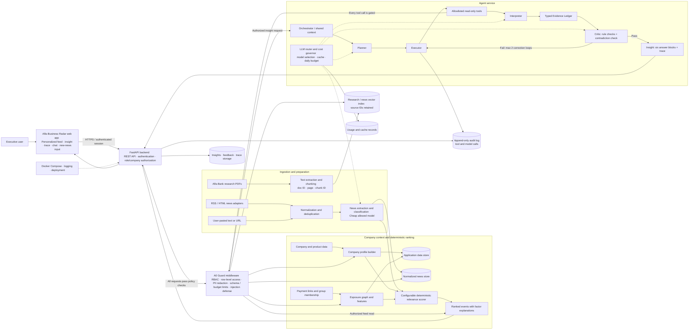

# Alfa Radar — Product Requirements Document

*Alfa Hack 2026 · Case: News Analytics for Business Decisions · Version 1.0 · Team of 3 · 4-day sprint*

## 1. Overview

Alfa Radar is an intelligent service embedded in the Alfa-Business internet bank that turns a stream of external news and Alfa-Bank macro research into personalized, auditable business insights for executives of large companies (revenue above RUB 15 bn).
For every selected client and user role, the service answers six questions: what happened, why it matters for this company, what consequences are possible, which actions are relevant, how Alfa-Bank assesses it, and what the conclusion is based on.
One-line pitch: a News → Impact → Action engine where every sentence is labeled Fact, Alfa-Bank View, or AI Inference and can be traced to a source and to the company features that drove it.

## 2. Problem Statement

Large companies already have their own analytics and news sources. A raw news feed, or an AI re-telling of it, adds little. Executives need to understand the impact of an event on their specific business: their industry, counterparties, regions, financing structure, currency exposure and bank products. Alfa-Bank has macro research and client data but no tool that joins external events, bank analytics and company context into one explainable output.

## 3. Goals and Non-Goals

### Goals

- G1. Determine the business context of a client from the provided data and select only the events that matter to that client.

- G2. Produce deep, multi-factor interpretation (consequences, risks, opportunities, next actions), not a summary.

- G3. Make the origin of each conclusion visible: client features, news sources, bank analytics, model inference.

- G4. Demonstrate real agentic behavior: planning, tool use, shared context, self-check and correction.

- G5. Deliver a working, reproducible prototype that handles previously unseen news.

### Non-Goals

- A generic news feed or an AI news summarizer.

- Use of any LLM outside the allowed list, or any external AI service or ready-made multi-agent system as the core component.

- Real identification of companies or people (all data is anonymized).

- Production-grade security hardening (documented and shown in the architecture only).

## 4. Target Users

The service is built for people, not legal entities; one company can have several users with different information needs.

| Persona | Primary interest | Example insight focus |
| --- | --- | --- |
| CEO / owner | Strategic risk, competitors, regulation | Sector shifts, sanctions, demand changes |
| CFO | Cost of debt, FX, covenants | Key rate decisions, ruble moves, refinancing |
| Treasurer | Liquidity, deposits, hedging | Rate path, bond market, settlement risks |
| Chief accountant | Tax and reporting changes | Regulatory changes, deadlines |
| Other decision influencer | Operational exposure | Supplier and logistics events |

## 5. Constraints from the Case

- Allowed LLMs only: Gemma 4 26B A4B, GLM-5.3-Flash, Qwen3.6 35B A3B, DeepSeek-V4.1-Flash, Qwen3-VL-30B-A3B-Instruct, Kimi-K2.6.

- Shared API key with a daily budget of RUB 500 during development.

- Agent logic must be implemented by the team: planning, tool use, context, self-check.

- Alfa-Bank views must be distinguishable from AI-generated conclusions.

- Must work with incomplete, ambiguous and noisy data.

- Security mechanisms (access control, sensitive data protection, tool-call logging, restrictions on unsafe actions) must be described and placed in the architecture.

- Submission: GitHub repo with commit hash/tag, README.md, Docker configuration, lock files, THIRD_PARTY_NOTICES, synthetic test data and test accounts. Grader account for private repo: alfa-hack-2026.

- A working, interactive prototype is required, preferably deployed on a free external server.

## 6. Scope and Functional Requirements

Priority: P0 must have, P1 should have, P2 nice to have.

### 6.1 Client Context and Ranking

| ID | Requirement | Priority |
| --- | --- | --- |
| FR-1 | Build a company profile from the provided tables (industry, scale, region, products, FTS flag/country, group, age, development stage). | P0 |
| FR-2 | Build an exposure graph from payment links and group membership; derive supplier and client industries and concentration. | P0 |
| FR-3 | Compute a deterministic relevance score per (news, company) using configurable weights. | P0 |
| FR-4 | Rank the feed per company and per role; show the top reasons for each rank. | P0 |
| FR-5 | Deduplicate and cluster similar news items. | P1 |

### 6.2 News and Analytics Ingestion

| ID | Requirement | Priority |
| --- | --- | --- |
| FR-6 | Ingest external news from available sources (RSS/HTML) and a synthetic set; normalize into a common schema. | P0 |
| FR-7 | Ingest Alfa-Bank research PDFs, chunk them, and index with source IDs and page numbers. | P0 |
| FR-8 | Classify news and extract key facts, entities, regions, sectors, macro factors, sentiment. | P0 |
| FR-9 | Accept a new news item pasted by the user (text or URL) and run the full pipeline on it. | P0 |

### 6.3 Interpretation and Agent Logic

| ID | Requirement | Priority |
| --- | --- | --- |
| FR-10 | Planner decides which data and sources are needed and creates an ordered step list. | P0 |
| FR-11 | Executor calls tools (company profile, exposure, news search, bank analytics search) and stores results in a shared context. | P0 |
| FR-12 | Interpreter produces the structured insight with the six answers, each claim typed and sourced. | P0 |
| FR-13 | Critic verifies completeness, consistency and source coverage, and triggers re-search or revision when checks fail. | P0 |
| FR-14 | Role Lens: same event interpreted differently for CEO, CFO and treasurer. | P1 |
| FR-15 | Suggested next actions, follow-up questions and scenarios; optional labeled native product mention. | P1 |

### 6.4 User Experience

| ID | Requirement | Priority |
| --- | --- | --- |
| FR-16 | Persistent, visible entry point (Radar widget) on the Alfa-Business home screen. | P0 |
| FR-17 | Personalized feed with relevance reasons. | P0 |
| FR-18 | Insight page with the six answers and three visual claim labels (Fact, Bank View, AI Inference). | P0 |
| FR-19 | Agent Trace panel: steps, tools called, sources used, company features applied, Critic outcomes. | P0 |
| FR-20 | Follow-up chat: ask a clarifying question, request another cut of data, open the original source. | P1 |
| FR-21 | "Test a new news item" input available in the UI. | P0 |
| FR-22 | Feedback buttons (useful / not useful / wrong) stored for quality monitoring. | P1 |
| FR-23 | Quality and cost dashboard (metrics, budget meter). | P2 |

### 6.5 Platform

| ID | Requirement | Priority |
| --- | --- | --- |
| FR-24 | Role-based access, masking of sensitive fields before prompts, allowlisted tools, audit log of every tool call. | P0 (design) / P1 (implementation) |
| FR-25 | LLM router and cost governor: cheap model for extraction, stronger model for reasoning, caching, daily budget meter. | P0 |
| FR-26 | Docker Compose startup, lock files, README, THIRD_PARTY_NOTICES, synthetic data, test accounts, OpenAPI spec. | P0 |

## 7. Core User Flow

1. The user signs in with a test account and sees the Radar widget on the home screen.

1. The user opens Radar and selects a company and a role (demo mode allows switching clients).

1. The feed shows ranked events with a one-line reason (for example, "you have credit products and the key rate changed").

1. The user opens an event and sees the six answers, with Fact, Bank View and AI Inference labels and source links.

1. The user opens the Agent Trace to see steps, tools, sources, features and Critic checks.

1. The user asks a follow-up question or opens the original source.

1. The user pastes a new, unseen news item and receives a fresh personalized insight.

1. The user leaves feedback.

## 8. System Architecture

### 8.1 Components

- Frontend (web app): feed, insight view, trace panel, chat, new-news input, role switch.

- Backend API (FastAPI): REST endpoints, authentication and roles, orchestration entry points, audit log.

- Data layer: company features, exposure graph, news store, bank-research chunks, feedback and trace storage.

- Scoring engine: deterministic relevance from configuration.

- Agent service: Planner, Executor, Interpreter, Critic, tool registry, LLM router.

- Retrieval: embeddings and vector index over bank research and news, with source IDs.

- Ops: Docker Compose, free-tier deployment, logging.

### Architecture Diagram



**Trust and data boundary:** News pages and research documents are untrusted input. They are normalized and treated as evidence, never as instructions. The agent can access only validated, allowlisted read-only tools. Sensitive client fields are masked before model calls, and model/tool activity is recorded in the audit log.

### 8.2 Data Flow

News or pasted text → normalization → extraction (cheap model) → scoring against company profiles → top events per company → agent loop (plan, tools, interpret, critic) → typed Evidence Ledger → UI with labels and trace.

### 8.3 Evidence Ledger (inter-component JSON contract)

Every claim is an object, so the UI, the Critic and the audit log all use one format.

```json
{
  "text": "string",
  "type": "FACT | BANK_VIEW | AI_INFERENCE",
  "source_ids": [
    "news:123",
    "bank:rate_note:p2"
  ],
  "company_features": [
    "CL_PRODUCT_LOA_MARK",
    "top_suppliers_okved"
  ],
  "confidence": 0.0
}
```

An insight contains six blocks: what_happened, why_it_matters, consequences, actions, bank_view, basis, plus relevance_score and trace.

### 8.4 Relevance Score

```
score = 0.30 * sector_match
      + 0.20 * supply_chain_exposure
      + 0.20 * product_match
      + 0.15 * geo_match
      + 0.10 * scale_weight
      + 0.05 * recency
```

Weights live in a YAML config. The LLM extracts structured event attributes only; ranking is deterministic, cheap and explainable.

### 8.5 Agent Design

The agent system is decomposed into a deterministic security boundary (A0) and task-focused modules (A1–A6). These are team-implemented components, not an external multi-agent framework. Every data or tool access must pass through A0; agents receive only the scoped, validated context required for their task.

#### 8.5.1 A0 — Guard middleware (not an LLM)

- **Responsibilities:** authentication and role-based access control (RBAC), company/row-level authorization, PII redaction, schema and parameter validation, step/token limits, and prompt-injection defenses.

- **Invariant:** no agent can read client data or invoke a tool without passing through this layer. Tools are allowlisted, read-only, and have no external-action or write capability.

- **Audit:** record authorization decisions and every tool/model call; persist the audit trail with the request trace.

#### 8.5.2 A1 — Orchestrator / Planner

- **Model:** GLM-5.3-Flash for reasoning, with a mostly templated plan to control cost.

- **Responsibilities:** decompose a request, choose tools and their order, decide when to stop, coordinate verification and correction, and track the token/budget envelope.

- **Tools:** `plan_write` and `budget_check`; delegates work to the A2–A6 modules through the Executor and A0.

- **Behavior:** output a short JSON plan of at most 6 steps; reuse cached results; permit at most 2 correction iterations. If the budget is exhausted, return the best available result with reduced confidence rather than continuing model calls.

- **Context contract:** reads `CaseContext`; writes the plan, verification state, and budget state.

#### 8.5.3 A2 — News Intake (classifier / extractor)

- **Model:** Gemma 4 26B A4B for high-volume extraction and classification.

- **Responsibilities:** classify event type/topic; extract entities, industries, macro factors, countries/regions, dates, figures, and actors; distinguish reported fact from speculation; flag sentiment, risk, opportunity, language, and noise.

- **Tools:** `parse_url`, `normalize_text`, `extract_entities`, and `dedupe`.

- **Behavior:** run once per news item, not once per customer. Return JSON only and validate against a schema; use `null` for absent fields rather than inventing values. Treat all news text as untrusted input.

#### 8.5.4 A3 — Profiler (company profile)

- **Implementation:** primarily deterministic processing with pandas, DuckDB, or NetworkX; Gemma or Qwen3.6 may produce a compact profile card of at most 300 tokens when useful.

- **Responsibilities:** derive hierarchical OKVED industry, scale from revenue and employee bands, product/financial exposure, foreign exposure from FTS fields, group structure from `GROUP_ID`, supply-chain exposure from the payment graph, and geographic footprint from company and linked-individual data.

- **Tools:** `get_company_profile`, `get_graph_exposure`, `get_group_view`, and `get_top_counterparties` (aggregated).

- **Behavior:** expose bins and aggregates rather than raw rows; pseudonymize counterparties and report missing fields. Read source CSVs/profiles only; write derived `client_features` to the shared context.

#### 8.5.5 A4 — Retriever (RAG over bank analytics)

- **Implementation:** BM25 with optional embeddings; little or no LLM use. Qwen3.6 may expand a query or extract a stance only if a bank card is missing.

- **Responsibilities:** construct retrieval queries from the event and customer characteristics, retrieve and rerank research chunks, and return Alfa-Bank's stance with an exact source citation.

- **Tools:** `search_bank_analytics`, `get_bank_card`, `search_news`, and `get_event`.

- **Behavior:** return an empty result when no relevant bank research exists and state that no bank view was found. Never invent a bank position or blend it with AI inference. Write retrieved evidence to `bank_analytics` with source IDs and page references.

#### 8.5.6 A5 — Ranker (deterministic, optional LLM tie-breaker)

- **Responsibilities:** score company × event × role, diversify near-duplicate results with maximal marginal relevance (MMR), and explain each score with its contributing factors.

- **Behavior:** the deterministic formula and weights in `scoring.yaml` are authoritative (see [Section 8.4](#84-relevance-score)). An LLM may break close ties only within the top 5–10 candidates when needed; it must not replace or obscure the deterministic score.

#### 8.5.7 A6 — Interpreter

- **Model:** GLM-5.3-Flash for deeper reasoning, or Kimi-K2.6 / Qwen3.6 selected by evaluation results.

- **Responsibilities:** connect event → customer characteristics → consequences → actions; consider second-order effects involving counterparties, FX, rates, and demand; produce scenarios and write in executive-level Russian.

- **Input boundary:** use `CaseContext` only; no unrestricted data access. Generate the six insight blocks and typed claims in the Evidence Ledger format from Section 8.3, with source IDs and company features attached to claims.

#### 8.5.8 Shared execution, Critic, and cost control

- **Executor:** executes the approved plan, dispatches A2–A6 functions through the allowlisted registry and A0, and stores outputs in the shared `CaseContext`. It does not grant agents direct access to databases or network tools.

- **Critic:** run deterministic checks first: every `FACT` has a valid source, every `BANK_VIEW` cites a bank document, “why it matters” references company features, and numerical claims agree with sources. Then check for contradictions. On failure, issue a targeted correction/re-search instruction to A1 and the Executor, with no more than 2 correction iterations.

- **Cost Governor:** route extraction/classification to Gemma 4 and reasoning to t

- he selected allowed reasoning model; cache extraction per news item, call `budget_check` before model work, meter tokens/cost, and enforce the RUB 500 daily development budget. Reuse cached work and degrade gracefully when the budget is exhausted.**Shared context:** carry only the request scope, role/company authorization, masked company features, normalized event attributes, retrieved evidence and citations, ranking explanation, plan, budget/verification state, and trace needed for the current insight.

### 8.6 Security Design

- Role-based access per user and company.

- Masking of sensitive fields before any prompt.

- Scraped news and PDFs treated as untrusted data (prompt-injection defense: delimiters, instruction stripping, output schema validation).

- Tool allowlist and parameter validation; no write or external-action tools.

- Immutable audit log of every tool call and model call.

## 9. Data

- Companies: industry codes and names, ownership form, age, development stage, employees, client type, product flags (settlement, guarantees, loans, leasing, deposits, payroll, factoring), FTS flag and country, revenue, group ID, city, region.

- Individuals (anonymized): links to companies and region, used for relationship analysis.

- Payments: payer, beneficiary, amount, count; used for the exposure graph.

- Bank research (9 documents): inflation, bond brief, gold, tactical view for Q3 2026, commodities, key rate, macro statistics (7M26 and 1H26), consumption.

- News: external sources plus a synthetic set with deliberate noise, duplicates and ambiguity.
**Known data caveat:** the case document lists the same file name for individuals and payments; confirm the real file names before implementation.

## 10. Success Metrics

| Area | Metric | Target |
| --- | --- | --- |
| Relevance | Precision@5 of feed on a labeled set | ≥ 0.7 |
| Traceability | Share of claims with valid source IDs | ≥ 95% |
| Faithfulness | Hallucination rate in a sampled audit | ≤ 5% |
| Agent quality | Critic rejection rate and successful recovery rate | tracked |
| Cost | Cost per insight and daily budget usage | ≤ RUB 500/day |
| Latency | Time to insight | ≤ 30 s |
| Usefulness | Thumbs-up ratio | tracked |

**Monitoring process:** weekly sampled expert review, thumbs feedback loop, drift check on score weights, and regression run on the fixed evaluation set before each release.

## 11. Mapping to Judging Criteria

| Criteria | Covered by |
| --- | --- |
| 01, 04 | Company profile, scoring, exposure graph, source linking |
| 02 | Six-answer interpretation with multi-factor logic |
| 03 | Fact / Bank View / AI Inference labels |
| 05 | "Test a new news item" flow |
| 06, 09, 10 | Home-screen widget, full flow, follow-up chat and source links |
| 07 | YAML-configured industries, source adapters, maintenance plan |
| 08 | Metrics and monitoring process |
| 11, 12 | Planner/Executor/Critic loop, Agent Trace, Evidence Ledger |

## 12. Team Roles and Responsibilities

Three owners, each with a clear boundary. Interfaces are frozen on Day 1 so the three streams can work in parallel.

### 12.1 AI Engineer

**Mission:** own everything that involves LLMs, retrieval and agent behavior, and prove that outputs are faithful and sourced.
**Owns:** LLM client and router, prompts, news extraction, RAG index, agent loop, Critic, evaluation set.

#### Day 1 (setup and contracts)

- Configure the LLM client against the shared key; verify exact model IDs and base URL; write a token and cost counter.

- Draft JSON schemas for event extraction and the Evidence Ledger (shared with Backend and Frontend).

- Write and test the extraction prompt on Gemma 4: event type, sectors, regions, countries, entities, macro factors, sentiment.

- Extract text from the nine bank research PDFs; chunk into 300–500 tokens with doc_id, title, page, chunk_id.

- Choose and run a multilingual embedding model; build the FAISS (or pgvector) index.

#### Day 2 (end-to-end thin slice)

- Implement search_bank_analytics(query, k) returning chunks with source IDs.

- Implement Planner, Executor with a shared context object, and Interpreter producing a valid Evidence Ledger.

- Integrate Backend tools (get_company_profile, get_exposure, rank_news_for_company) through the tool registry.

- Reach the Day-2 milestone: one request returns a complete, sourced insight.

#### Day 3 (quality and differentiators)

- Implement the Critic: deterministic checks, then LLM contradiction check, correction loop (maximum 2 iterations), trace entries.

- Implement Role Lens prompt variants (CEO, CFO, treasurer).

- Implement the Cost Governor: model routing, caching, budget meter, graceful fallback to the cheaper model.

- Add prompt-injection defenses for untrusted news text and PDFs.

- Build the evaluation set: 10 unseen news items and 5 noisy or ambiguous cases; compute source coverage, rejection rate, cost per insight.

#### Day 4 (hardening)

- Freeze prompts and parameters; run the regression on the evaluation set.

- Write the AI section of README (agent design, prompts, models used, safety) and the model entries in THIRD_PARTY_NOTICES.

- Prepare demo answers on hallucination control and cost control.
**Deliverables:** agents/ package, prompts folder, RAG index builder, evaluation script and report.
**Definition of done:** every claim carries source IDs, Critic catches at least one seeded error in the demo, daily cost stays within budget, and results hold on unseen news.

### 12.2 Backend Engineer

**Mission:** own data, scoring, graph, APIs, security controls and deployment so that the system is reproducible and reliable.
**Owns:** data cleaning and feature building, exposure graph, scoring engine, ingestion, REST API, persistence, audit log, Docker and deployment.

#### Day 1 (setup and data)

- Create the repository, folder structure, virtual environment, lock file, .env.example, Docker skeleton and commit conventions.

- Place the jury data in data/raw; profile every file (types, missing rates, duplicates, inconsistent city and region spelling, revenue outliers); confirm real file names.

- Build companies.parquet: deduplicate IDs, normalize text, derive okved2, revenue buckets, product flags, is_exporter, FX exposure, group size.

- Build the payment graph and graph_features.parquet (top suppliers and clients by industry, concentration).

- Publish the OpenAPI draft and a mock server so Frontend can start immediately.

#### Day 2 (scoring, ingestion, API)

- Implement the scoring engine from scoring.yaml with per-factor explanations.

- Implement news ingestion: RSS/HTML adapters, normalization, deduplication, synthetic news loader.

- Expose the tool functions for the agent: company profile, exposure, news search, ranking.

- Implement endpoints: GET /companies, GET /feed, POST /insight, POST /ingest, GET /trace/{id}, POST /feedback.

- Persist insights, traces and feedback.

#### Day 3 (security and robustness)

- Implement authentication with test accounts, role-based access, field masking before prompts, tool allowlist and parameter validation.

- Implement the audit log for tool and model calls.

- Add noisy-data handling: missing fields, unknown industry codes, empty graph neighborhoods, graceful defaults.

- Write unit and integration tests for scoring, ingestion and API contracts.

- Support the Frontend with CORS, pagination and error formats.

#### Day 4 (delivery)

- Finalize Docker Compose; verify a clean clone starts with docker compose up --build.

- Deploy to a free external server; record the public URL; prepare test accounts and synthetic data.

- Write the platform sections of README, OpenAPI export, THIRD_PARTY_NOTICES for libraries and datasets, scalability and maintenance notes (industry rules in YAML, source adapters).

- Tag the submission release and record the commit hash.
**Deliverables:** backend/ service, data pipeline scripts, scoring.yaml, tests, Docker setup, deployment, OpenAPI spec.
**Definition of done:** clean-clone startup works, endpoints match the OpenAPI contract, scoring explanations are returned with every rank, and the audit log records every tool call.

### 12.3 Frontend Engineer

**Mission:** make the value visible. The interface must show personalization, the three claim labels and the agent trace in a demo-ready, interactive prototype.
**Owns:** web app, Alfa-Business style home screen with the Radar widget, feed, insight view, trace panel, chat, new-news tester, role and client switchers, feedback UI.

#### Day 1 (design and skeleton)

- Set up the frontend project (Next.js or equivalent), lint, build and Docker file.

- Design the three-panel layout: feed, interpretation, agent trace; define the visual labels for Fact, Bank View and AI Inference.

- Build a mocked Alfa-Business home screen with a prominent, always-visible Radar entry widget.

- Generate an API client from the OpenAPI draft and work against the mock server.

#### Day 2 (core screens)

- Build the client and role selector and the personalized feed with relevance score and reason chips.

- Build the insight page with the six answer blocks and typed claim rendering; each claim shows source chips that open the source.

- Connect to the real GET /feed and POST /insight as soon as they are available.

#### Day 3 (differentiators)

- Build the Agent Trace panel: ordered steps, tools called, sources used, company features applied, Critic checks and retries.

- Build the "Test a new news item" input (text or URL) with progress states.

- Build the follow-up chat and the "open original source" action.

- Build feedback buttons and loading, empty and error states.

- Add the optional quality and cost dashboard (P2) if time allows.

#### Day 4 (polish and demo)

- Responsive and accessibility pass; consistent typography and color; remove debug artifacts.

- Prepare the demo path: two contrasting clients on the same news, one full insight, the trace, a new pasted news item.

- Record a backup screen capture of the demo in case of network issues.

- Write the UI section of the README and the user-scenario walkthrough for graders.
**Deliverables:** frontend/ app, UI component library for claim labels, demo script, screenshots.
**Definition of done:** a grader can complete the full scenario (sign in, choose a client, read a labeled insight, inspect the trace, test new news) without help, on desktop and mobile widths.

### 12.4 Shared Responsibilities

| Item | Owner | Support |
| --- | --- | --- |
| Evidence Ledger schema | AI Engineer | Backend, Frontend review |
| OpenAPI contract | Backend | Frontend, AI Engineer review |
| README structure | Backend | Each owner writes their section |
| THIRD_PARTY_NOTICES | Backend | AI Engineer adds models and datasets |
| Demo script and rehearsal | Frontend | All three |
| Synthetic news set | AI Engineer | Backend loads it |
| Evaluation and metrics | AI Engineer | Backend exposes metrics endpoint |

### 12.5 Collaboration Rules

- Freeze the Evidence Ledger schema and OpenAPI draft by the end of Day 1; changes require agreement of all three.

- Short branches and pull requests; main stays runnable at all times.

- Fifteen-minute sync at the start of each day and a thirty-minute integration check in the evening.

- No new features after the Day-4 midday cut-off; only fixes.

## 13. Timeline Summary

| Day | Milestone |
| --- | --- |
| 1 | Environment, cleaned data, graph, schemas, bank research indexed, OpenAPI and mock server, UI skeleton |
| 2 | End-to-end thin slice: feed, scoring, one full sourced insight in the UI |
| 3 | Critic, Role Lens, Cost Governor, Agent Trace, new-news input, security controls, tests |
| 4 | Docker verification, deployment, documentation, demo rehearsal, release tag and commit hash |

**Scope-cut order if time is short:** dashboard, free chat, native product mention, Role Lens, graph depth.

## 14. Risks and Mitigations

| Risk | Impact | Mitigation |
| --- | --- | --- |
| Daily token budget exhausted | Demo fails | Router, caching, small-model extraction, budget meter, pre-generated cache for demo items |
| Hallucinated numbers or sources | Credibility loss | Deterministic Critic checks, source-ID validation, strict schema |
| Noisy or inconsistent data | Wrong personalization | Defaults, normalization, confidence flags, tests on edge cases |
| Product looks like a news feed | Low score | Impact-first layout, six-answer structure, bank view emphasis |
| Demo depends on prepared scenarios | Fails the unseen-news criterion | Live "test new news" flow, evaluation on unseen items |
| Prompt injection via scraped text | Unsafe behavior | Untrusted-data handling, schema validation, tool allowlist |
| Integration slip between streams | Late delivery | Frozen contracts on Day 1, mock server, daily integration check |
| Commits after the deadline | Disqualified changes | Release tag and hash recorded before the deadline |

## 15. Submission Checklist

- ☐ GitHub repository with history; tag and commit hash recorded; access for alfa-hack-2026 if private

- ☐ README.md: purpose, architecture, environment, run instructions, configuration, components, verification scenario

- ☐ Docker Compose that starts all components from a clean clone

- ☐ Lock files for language and dependencies

- ☐ THIRD_PARTY_NOTICES covering libraries, models, datasets, services and simulated integrations

- ☐ Synthetic data and test accounts for the end-to-end scenario

- ☐ Public deployment URL

- ☐ Architecture diagram, OpenAPI spec, data model and test scenarios

- ☐ Demo script rehearsed twice and a backup recording

## 16. Open Questions

- What are the real file names and delimiters for individuals and payments data?

- Exact API base URL and model IDs for the allowed LLMs?

- Which external news sources are officially acceptable to scrape?

- Is there a style guide or component kit for the Alfa-Business interface?

- Will graders use their own unseen news items during the live check?

